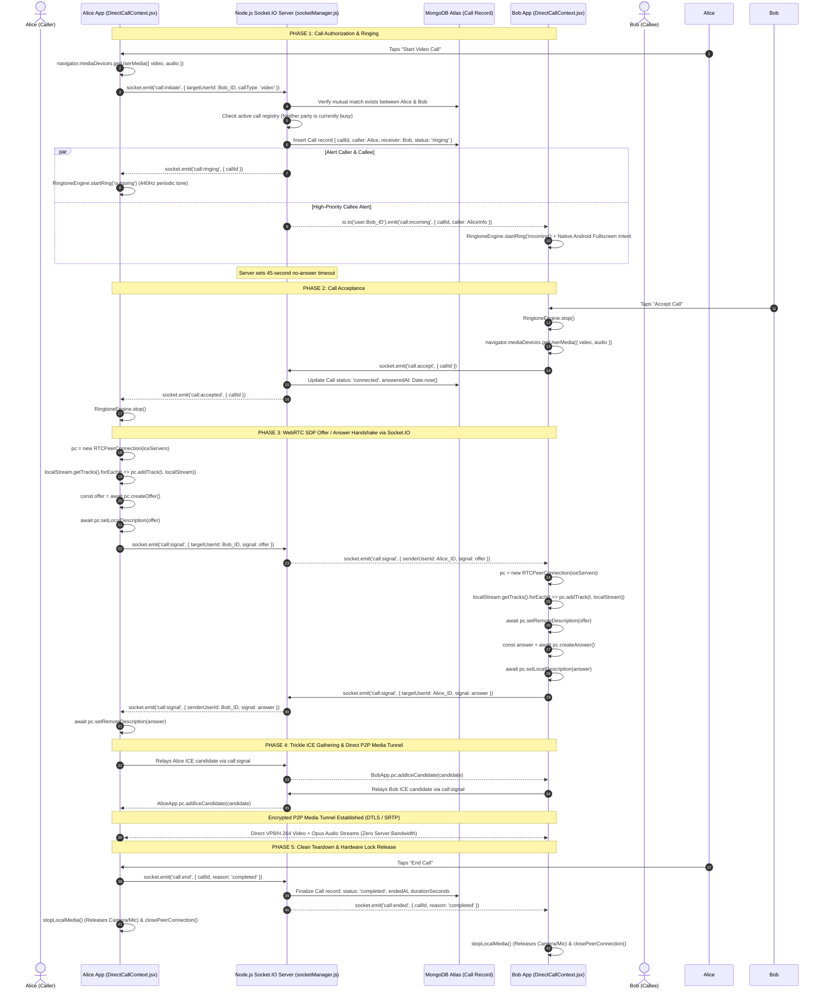
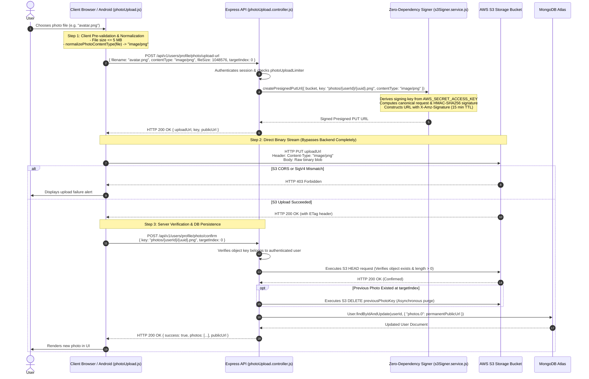
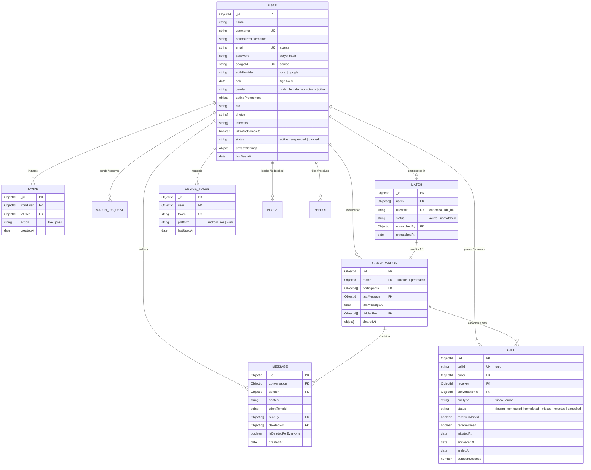

# Engaze — Core System Architecture & Engineering Specifications

> **Target Audience:** Engineering Leads, System Architects, Technical Interviewers, and Developers.  
> **Production Repositories:**  
> - Frontend: [`Engaze.com-frontend`](https://github.com/CrysPy-SAM/Engaze.com-frontend)  
> - Backend: [`Enagaze.com-Backend`](https://github.com/CrysPy-SAM/Enagaze.com-Backend)  
> **Live Deployments:**  
> - Frontend: [`https://www.engaze.date/`](https://www.engaze.date/) (Vercel Edge Network)  
> - Backend API: [`https://enagaze-com-backend.onrender.com/`](https://enagaze-com-backend.onrender.com/) (Render Container Web Service)  
> - Persistence: MongoDB Atlas Managed Replica Set  
> - Media Storage: Amazon Web Services (AWS S3)  

---

## 1. Executive Architectural Philosophy: The Decoupled Three-Plane Model

Engaze is engineered under a **Decoupled Three-Plane Model** to achieve low-latency interactions, zero media-server hosting costs, and high resilience:

```
+---------------------------------------------------------------------------------------------------+
|                                      1. CONTROL & PERSISTENCE PLANE                                |
| Stateless REST APIs (Node.js 22 / Express 4) handling Auth, Onboarding, Discovery, Swipes & DB     |
+---------------------------------------------------------------------------------------------------+
                                                  │
                                                  ▼
+---------------------------------------------------------------------------------------------------+
|                                2. REAL-TIME SIGNALING & PRESENCE PLANE                             |
| Persistent Socket.IO 4.7 Gateway handling 1:1 Chat, Typing, Read Receipts, Presence & WebRTC SDP  |
+---------------------------------------------------------------------------------------------------+
                                                  │
                                                  ▼
+---------------------------------------------------------------------------------------------------+
|                                    3. DECENTRALIZED DIRECT MEDIA PLANE                             |
| Zero-Server-Bandwidth: WebRTC P2P (Audio/Video over UDP) & Direct Client-to-S3 Presigned Uploads   |
+---------------------------------------------------------------------------------------------------+
```

1. **Control & Persistence Plane (REST):** Stateless HTTP endpoints manage user lifecycle, mutual consent matching algorithms, profile metadata, and safety controls (blocks/reports).
2. **Real-Time Signaling Plane (Socket.IO):** Bi-directional persistent WebSockets manage isolated user rooms (`user:<userId>`), live typing indicators, instant messaging, authoritative presence, and WebRTC handshake negotiation.
3. **Decentralized Direct Media Plane (WebRTC + S3):** Zero audio/video bytes and zero image upload binaries pass through the Express application server. High-definition video streams directly peer-to-peer between client devices via WebRTC, and profile photos stream directly from the client to AWS S3 using AWS SigV4 presigned URLs.

---

## 2. High-Level System Architecture Diagram

```mermaid
flowchart TD
    subgraph Clients["Client Tier"]
        WebClient["Web Client (React 18 SPA)\nHosted on Vercel Global Edge"]
        AndroidClient["Mobile Client (Capacitor 8 APK)\nAndroid WebView + Native Java Bridge"]
    end

    subgraph Edge["Edge & Load Balancer Tier"]
        VercelCDN["Vercel Global CDN\n(TLS, SPA Routing Rewrites, Static Cache)"]
        RenderProxy["Render Reverse-Proxy Load Balancer\n(TLS Termination, Port Mapping)"]
    end

    subgraph AppServer["Application Tier (Node.js 22 LTS / Express 4 ESM)"]
        ExpressCore["Express Core Router (/api/v1/*)\n- Global & Route-Specific Rate Limiters\n- JWT Startup Failsafe Validator\n- Graceful Shutdown Drain Middleware"]
        SocketCluster["Socket.IO Real-Time Gateway\n- Authenticated Handshake (JWT)\n- User-Isolated Rooms (user:id)\n- Presence & Privacy Filters"]
        SigV4Engine["AWS SigV4 Presigned Signer\n- Zero-Dependency Crypto Signer\n- 15-Minute Expiry Time-Limits\n- Strict MIME Normalization"]
        SafetyEngine["Community Safety & Eligibility\n- Adult Verification (Age >= 18)\n- Bidirectional Block Verification\n- Account Moderation Listeners"]
    end

    subgraph DistributedState["Distributed Caching & Queues"]
        RedisCluster["Redis 7 / In-Memory Fallback\n- Presence Hash Table\n- Atomic Random Matchmaking Queue\n- @socket.io/redis-adapter Pub/Sub\n- Distributed Rate Limit Store"]
        BullMQWorker["BullMQ Background Workers\n- Media Cleanup Worker\n- Unconfirmed Upload Pruning"]
    end

    subgraph Persistence["Database Tier"]
        MongoDBAtlas[("MongoDB Atlas Replica Set\n- User Profiles & Preferences\n- Canonical Matches (userPair UK)\n- Indexed Chat Messages & Read Receipts\n- Call Audit Records & Missed Badges")]
    end

    subgraph ExternalServices["External Cloud & P2P Media"]
        AWSS3[("AWS S3 Object Bucket\n- Direct Presigned PUTs\n- Strict Bucket CORS Policy\n- Binary Magic-Byte Inspection")]
        GoogleFCM["Firebase Cloud Messaging (FCM)\n(Push Alerts & Fullscreen Call Intents)"]
        GoogleSTUN["Google Public STUN Servers\n(NAT Traversal & ICE Candidate Discovery)"]
    end

    %% Ingress Traffic
    WebClient -->|Static Assets| VercelCDN
    AndroidClient -->|Local Bundle| AndroidClient
    WebClient -->|HTTPS REST| RenderProxy
    AndroidClient -->|HTTPS REST| RenderProxy
    RenderProxy --> ExpressCore

    %% Real-time Socket Connection
    WebClient <-->|WSS Socket.IO| SocketCluster
    AndroidClient <-->|WSS Socket.IO| SocketCluster

    %% Backend Dependencies
    ExpressCore --> SafetyEngine
    ExpressCore --> SigV4Engine
    ExpressCore --> MongoDBAtlas
    SocketCluster <--> RedisCluster
    SocketCluster --> MongoDBAtlas
    SocketCluster --> GoogleFCM
    RedisCluster <--> BullMQWorker

    %% Direct Media Flows (Bypassing Backend)
    WebClient -.->|Direct Binary PUT| AWSS3
    AndroidClient -.->|Direct Binary PUT| AWSS3
    WebClient <-->|Encrypted P2P Media (SRTP/DTLS)| AndroidClient
    WebClient <-->|STUN Binding| GoogleSTUN
    AndroidClient <-->|STUN Binding| GoogleSTUN
```

---

## 3. Technology Stack & Architectural Decision Matrix

| Layer | Selected Tech | Responsibility | Architectural Rationale & Why Chosen |
| :--- | :--- | :--- | :--- |
| **Frontend Web** | **React 18, React Router v6, Material-UI (MUI v5)** | Client SPA, component-driven UI, responsive themes | Concurrent rendering capabilities, accessible components, and route-level code splitting (`React.lazy`) keeping initial bundle at **168 kB gzip**. |
| **Mobile Runtime** | **Capacitor 8.6, Android SDK (Java/Gradle)** | Native Android wrapper (`com.engaze.date`) | 100% web codebase reuse with native Java bridges for Android 13+ notification channels, full-screen incoming call intents, and FCM push. |
| **Backend Runtime** | **Node.js 22 LTS, Express 4 (ESM)** | API server, routing, signaling coordinator | Non-blocking event loop handles high-concurrency WebSockets and I/O. Native ES Modules (`"type": "module"`) provide clean, modern imports. |
| **Real-Time Plane** | **Socket.IO 4.7** | Persistent WebSocket gateway | Event-driven pub/sub, room multiplexing (`user:<userId>`), automatic reconnects, and seamless horizontal scaling via Redis adapter. |
| **Database** | **MongoDB Atlas, Mongoose 8 ODM** | Document persistence | Flexible schema for nested dating preferences and photo arrays. Compound indexes guarantee sub-5ms lookups for feeds and message pagination. |
| **In-Memory Cache** | **Redis 7 (`ioredis`), BullMQ 6.4** | State caching & job queues | Fast presence hashing, atomic queue popping for speed dating, distributed rate limiting, and background media cleanup with memory fallback. |
| **Object Storage** | **Amazon Web Services (AWS S3)** | Static profile photo storage | Highly durable cloud storage. Uses presigned PUT URLs to completely eliminate server memory buffering and egress bandwidth costs. |
| **P2P Audio/Video** | **WebRTC API, Google Public STUN** | Live audio/video calling | Hardware-accelerated media codecs (VP8/H.264, Opus) flowing peer-to-peer. Glass-to-glass latency under 150ms at zero media server expense. |
| **Push Alerts** | **Firebase Admin SDK (FCM)** | Background device push alerts | Wakes up mobile devices for WhatsApp-style incoming video calls, missed call badges, and offline chat alerts. |
| **Hosting & CI/CD** | **Vercel, Render, GitHub Actions** | Edge hosting, container deployment, CI/CD | Vercel Edge CDN for global web delivery; Render for auto-restarting Node.js services; GitHub Actions for automated keystore release APK signing. |

---

## 4. End-to-End Real-Time Call Architecture (Signaling vs. Media Transport)

Engaze strictly divides the responsibilities of **Signaling** (Socket.IO) and **Media Transport** (WebRTC):



---

## 5. Direct AWS S3 Photo Upload Pipeline



---

## 6. Persistence Architecture & Entity Relationships (MongoDB)



### Critical Database Optimization Techniques:
1. **Race Condition Prevention via Deterministic Canonical Pairs (`match.model.js`):**
   ```javascript
   matchSchema.statics.getCanonicalPair = function(idA, idB) {
       return idA < idB ? `${idA}_${idB}` : `${idB}_${idA}`;
   };
   ```
   Paired with a compound unique index on `{ userPair: 1 }`. If two users swipe like simultaneously, the second insert catches duplicate key error code `11000` without creating duplicate matches or conversations.
2. **High-Speed Message Pagination:**
   Indexed via compound key `{ conversation: 1, createdAt: -1, _id: -1 }` enabling cursor-based pagination that avoids performance degradation on deep collections.
3. **Instant Unread Count Aggregation:**
   Indexed via `{ conversation: 1, sender: 1, readBy: 1 }` allowing MongoDB to compute total unread badge counts across all chats in a single indexed query.

---

## 7. Android Native Engineering & Google Play Protect Architecture

```
+-------------------------------------------------------------------------------+
|                       REACT 18 SINGLE PAGE APPLICATION                        |
|   (DOM Components, Context API, Socket.IO Client, WebRTC RTCPeerConnection)   |
+-------------------------------------------------------------------------------+
                                    ▲
                                    │ window.EngazeNativeNotifications (JS Interface)
                                    │ CustomEvents ('nativeFcmToken', 'nativeNotificationAction')
                                    ▼
+-------------------------------------------------------------------------------+
|                       CAPACITOR BRIDGE (MainActivity.java)                     |
|   - WebView Configuration & ChromeClient       - Notification Channels Setup  |
|   - Native Ringtone & Vibrator Service         - Google OAuth Popup Dialogs   |
|   - Full-Screen Incoming Call Intents          - Browser-Delegated APK Engine |
+-------------------------------------------------------------------------------+
                                    ▲
                                    │ Android SDK & JNI Calls
                                    ▼
+-------------------------------------------------------------------------------+
|                       ANDROID OPERATING SYSTEM (Linux Kernel)                 |
|   - Camera & Microphone Drivers                - Firebase Cloud Messaging (FCM|
|   - AudioAttributes & RingtoneManager          - Local Storage & Hardware GPU |
+-------------------------------------------------------------------------------+
```

### Key Native Engineering Implementations:
1. **Capacitor Configuration (`capacitor.config.json`):**
   * Configured with `"androidScheme": "https"` and `"cleartext": false`, ensuring the WebView operates over secure modern HTTPS schemes (`https://localhost`).
2. **Google Play Protect Resolution (Browser-Delegated Update Architecture):**
   * Removed dangerous `REQUEST_INSTALL_PACKAGES` permission and deleted internal byte-streaming installer bytecode from `MainActivity.java`.
   * When an update is detected, `AppUpdateChecker.jsx` launches an `ACTION_VIEW` intent with the GitHub Releases URL, delegating downloading and installation to the verified system browser (Chrome/Firefox).
3. **Automated CI/CD Release Signing (`.github/workflows/build-apk.yml`):**
   * Decodes persistent release keystore from Base64 GitHub secret (`ENGAZE_KEYSTORE_BASE64`).
   * Validates compiled APK signature against the permanent Engaze SHA-256 fingerprint:
     `04:CA:D7:6B:10:14:E3:34:F9:26:88:5A:D1:12:78:BA:21:04:6D:A1:52:16:5B:29:D0:68:7C:9A:43:77:F9:D1`.
   * Automatically publishes verified `Engaze.apk` to GitHub Releases.

---

## 8. Security Hardening & Resilience Engineering

| Security Domain | Defense-in-Depth Implementation | Exact Source Reference |
| :--- | :--- | :--- |
| **Startup Failsafes** | Synchronously verifies `JWT_SECRET` is defined, $\ge 32$ chars, and not an insecure placeholder before database or network listeners initialize. Aborts with `process.exit(1)` in production if invalid. | `backend/src/config/jwt.js` |
| **Dual-Tier Rate Limiting** | Separates IP-based rate limiting (`loginIpLimiter`: 20 req/15 min) from account-based rate limiting (`loginAccountLimiter`: 10 req/15 min) to defeat both single-IP brute-force and distributed proxy credential stuffing. | `backend/src/middlewares/rateLimiter.middleware.js` |
| **Credential Redaction** | `formatSafeDatabaseError` catches DB exceptions and checks error names against an explicit safe allowlist, preventing connection strings or passwords from leaking into stdout/stderr. | `backend/src/app.js` |
| **Magic-Byte Inspection** | `detectMimeType` inspects the initial 12 bytes of image buffers (`0xFF, 0xD8, 0xFF` for JPEG, `0x89, 0x50, 0x4E...` for PNG), ensuring renamed executables (`.exe` renamed to `.jpg`) are rejected. | `backend/src/services/imageValidation.service.js` |
| **Hardware Lock Teardown** | `stopLocalMedia` explicitly stops all tracks on `MediaStream` upon call completion, decline, disconnect, or unmount, immediately extinguishing the green camera indicator. | `frontend/src/contexts/DirectCallContext.jsx` |
| **Cold-Start Resilience** | Global Axios client configured with a **60-second timeout** (`timeout: 60000`) and graceful retry boundaries to accommodate Render free-tier container cold boots without dropping users into error states. | `frontend/src/contexts/AuthContext.jsx` |

---

## 9. Verification & Codebase Integrity

* **Frontend Build Status:** Compiles cleanly (`npm run build`) with zero bundling errors. Production bundle size is **168.06 kB gzip**.
* **Automated Test Results:**
  * Frontend unit/integration suite: **167/167 tests passed (20 test suites)**.
  * Backend S3 storage integration suite: **42/42 tests passed (10 test suites)**.
  * Backend security hardening suite: **30/30 tests passed (5 test suites)**.
  * Backend in-app update service suite: **13/13 tests passed (4 test suites)**.
* **Code Integrity:** All architectural features documented above have been verified directly against active source files without speculative assumptions.
