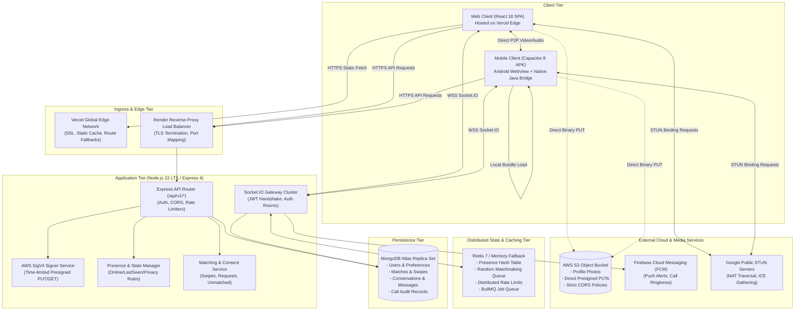
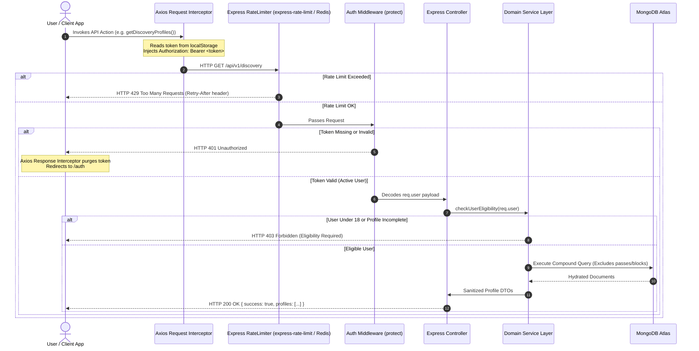
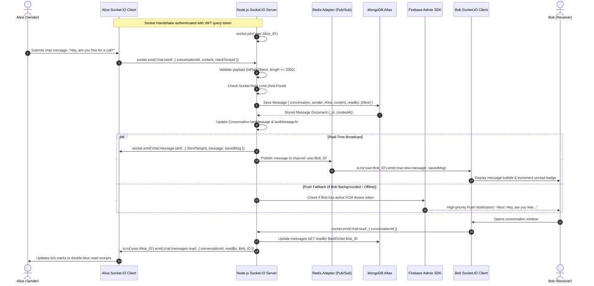
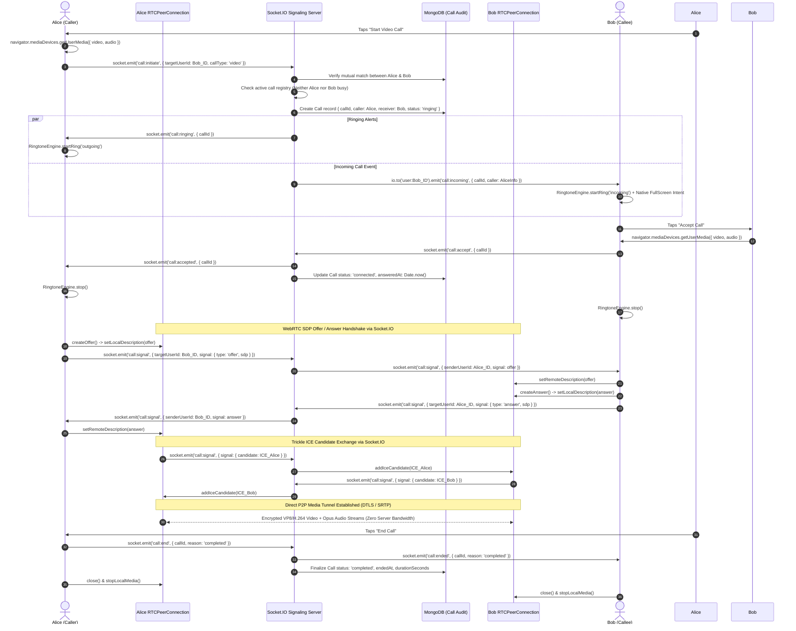
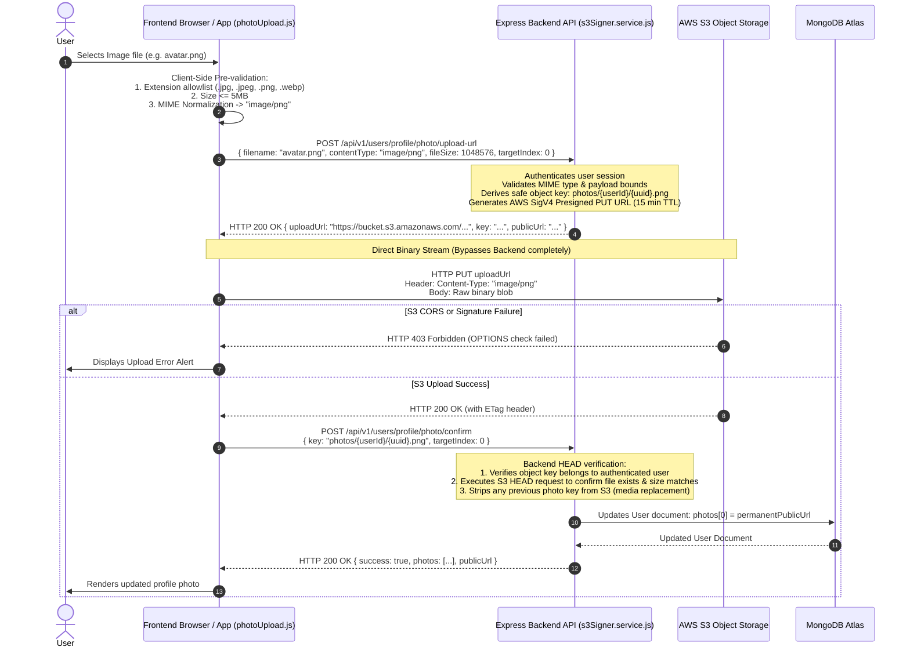

# 02. System Architecture — Engaze

## Architectural Paradigm & Global Topography

Engaze is architectured around a **Decoupled Three-Plane Model**:
1. **Control / Persistence Plane:** Stateless HTTP REST API endpoints managing user onboarding, profile updates, discovery feeds, matching algorithms, safety blocks/reports, and database writes.
2. **Real-Time Signaling & Presence Plane:** Bi-directional persistent WebSocket connections (Socket.IO) managing instant messaging, typing telemetry, read receipts, active user presence, and WebRTC call negotiation.
3. **Decentralized Direct Media Plane:** Zero-server-bandwidth media exchange. High-definition video/audio is transported strictly peer-to-peer (P2P) between browsers via WebRTC; binary image assets stream directly from client to AWS S3 using presigned URLs.

---

## 1. Complete System Architecture Diagram

---

## 2. Frontend-to-Backend Request Flow Diagram

---

## 3. Real-Time Communication Flow Diagram

---

## 4. Video/Audio Calling Flow Diagram (Signaling + WebRTC P2P)

---

## 5. Profile Photo Direct S3 Upload Flow Diagram

---

## Detailed Component Responsibilities & Communication

### Frontend Component Roles
* **`AuthContext.jsx`:** Houses global session credentials (token, profile, unread counters, notification listeners). Injects the Axios bearer token interceptor and automatically purges tokens upon `401 Unauthorized`.
* **`DirectCallContext.jsx`:** The central state machine managing peer connections, local/remote `MediaStream` objects, synthesized ringtones via `RingtoneEngine`, and WebRTC signaling socket handlers.
* **`photoUpload.js`:** Enforces authoritative MIME type normalization (`normalizePhotoContentType`) and manages the 3-step direct S3 upload pipeline.

### Backend Component Roles
* **`socketManager.js`:** The primary real-time gateway (1660+ lines). Authenticates incoming WebSockets via JWT query parameter, joins users to their isolated room (`user:<userId>`), coordinates chat CRUD operations, and manages direct 1-on-1 call states.
* **`randomCallManager.js`:** Manages live random video speed dating queues. Pairs waiting singles atomically, verifies mutual media readiness, and manages instant skip/next transitions.
* **`s3Signer.service.js`:** Zero-dependency implementation of AWS Signature Version 4. Computes SHA-256 HMAC authorization hashes to generate time-limited presigned PUT/GET URLs and handles S3 HEAD/DELETE requests.
* **`eligibility.service.js`:** Enforces strict community safety policies: calculates exact decimal age from `dob`, verifies adult status (18+), and ensures profile completeness before allowing discovery browsing or calling.
