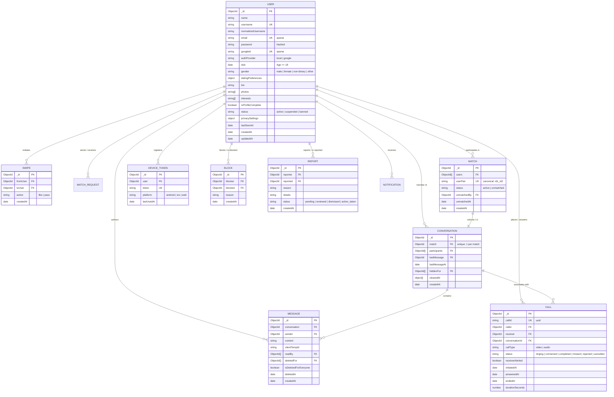

# 05. Database Design & Engineering — Engaze

## Database Paradigm: MongoDB Atlas & Mongoose 8

Engaze utilizes **MongoDB Atlas** (Managed Replica Set) coupled with **Mongoose 8 ODM**. A document-oriented architecture was chosen for its schema flexibility regarding polymorphic user profiles, dynamic interest tags, multiple photo URLs, and nested privacy settings, while compound indexing guarantees sub-5ms query performance for feeds and real-time chat histories.

---

## 1. Entity-Relationship (ER) Diagram



---

## 2. Comprehensive Schema Specifications & Indexing Strategies

### A. User Schema (`src/models/user.model.js`)
* **Purpose:** Stores user credentials, demographic profile, match preferences, account standing, and privacy controls.
* **Fields:**
  * `username` (`String`, required, unique): Min length 3, max 30, regex match `/^[a-zA-Z0-9_.-]+$/`.
  * `normalizedUsername` (`String`): Auto-populated by `pre("save")` hook to lowercase for fast case-insensitive lookup.
  * `dob` (`Date`): Custom validator using `calculateExactAge(value)` guaranteeing $18 \le \text{age} \le 120$.
  * `status` (`String`, enum: `active`, `suspended`, `banned`, default: `active`, indexed).
  * `privacySettings` (`Object`):
    * `lastSeen` (enum: `everyone`, `matches`, `matches_except`, `nobody`).
    * `lastSeenExceptions` (`[ObjectId ref "User"]`).
    * `online` (enum: `everyone`, `same_as_last_seen`).
* **Virtuals:** `age` computed dynamically on retrieval via `calculateExactAge(this.dob)`.
* **Transform hook (`toJSON` / `toObject`):** Automatically deletes `password`, `token`, and `__v` before document serialization.
* **Key Indexes:**
  * `{ username: 1 }` (unique)
  * `{ email: 1 }` (unique, sparse)
  * `{ googleId: 1 }` (unique, sparse)
  * `{ status: 1 }`

---

### B. Swipe Schema (`src/models/swipe.model.js`)
* **Purpose:** Records user interest or disinterest during discovery feed browsing.
* **Fields:**
  * `fromUser` (`ObjectId ref "User"`, required, indexed).
  * `toUser` (`ObjectId ref "User"`, required, indexed).
  * `action` (`String`, enum: `like`, `pass`, required).
* **Compound Unique Index:**
  ```javascript
  swipeSchema.index({ fromUser: 1, toUser: 1 }, { unique: true });
  ```
  **System Design Value:** Guarantees idempotency. Even if a user double-taps or a network retry sends concurrent swipe requests, MongoDB's unique index strictly enforces that a user can only swipe once per target profile, preventing duplicate database entries.
* **Performance Indexes:**
  * `{ fromUser: 1, action: 1 }`: Optimized for the "Reset Passes" feature (`POST /api/v1/discovery/reset`) which purges all records where `fromUser = currentUserId AND action = "pass"`.
  * `{ toUser: 1, action: 1 }`: Powers the "Likes You" feed query to instantly fetch who liked the current user.

---

### C. Match Schema (`src/models/match.model.js`)
* **Purpose:** Represents an active or historical mutual romantic match.
* **Fields:**
  * `users` (`[ObjectId ref "User"]`, length: 2).
  * `userPair` (`String`, required, unique, indexed): A deterministic canonical string representation of both users:
    ```javascript
    matchSchema.statics.getCanonicalPair = function (userId1, userId2) {
        const id1 = userId1.toString();
        const id2 = userId2.toString();
        return id1 < id2 ? `${id1}_${id2}` : `${id2}_${id1}`;
    };
    ```
    **System Design Value:** Completely prevents race condition duplicates. If Alice likes Bob and Bob likes Alice simultaneously in separate HTTP requests, both attempt to insert `Match` with `userPair = "AliceID_BobID"`. The second insert immediately fails with a duplicate key error (`E11000`), ensuring strictly **one** match record exists per pair.
  * `status` (enum: `active`, `unmatched`, default: `active`).
  * `unmatchedBy` (`ObjectId ref "User"`).
* **Key Indexes:**
  * `{ userPair: 1 }` (unique)
  * `{ users: 1, status: 1, createdAt: -1 }`: Powers the user's active matches feed with reverse-chronological sorting.

---

### D. Conversation Schema (`src/models/conversation.model.js`)
* **Purpose:** 1-to-1 chat channel metadata linked to a mutual match.
* **Fields:**
  * `match` (`ObjectId ref "Match"`, required, unique, indexed): Strict 1:1 mapping between a match and a conversation.
  * `participants` (`[ObjectId ref "User"]`, required).
  * `lastMessage` (`ObjectId ref "Message"`, default: null).
  * `lastMessageAt` (`Date`, default: Date.now, indexed).
  * `hiddenFor` (`[ObjectId ref "User"]`): Supports user conversation hiding/archiving.
  * `clearedAt` (`[{ user: ObjectId, at: Date }]`): Supports WhatsApp-style "Clear Chat" per user.
* **Key Indexes:**
  * `{ match: 1 }` (unique)
  * `{ participants: 1, lastMessageAt: -1 }`: Powers the `/api/v1/conversations` feed so conversations with recent messages always appear at the top.

---

### E. Message Schema (`src/models/message.model.js`)
* **Purpose:** Stores individual chat messages with read receipts, soft-deletes, and temporary client IDs.
* **Fields:**
  * `conversation` (`ObjectId ref "Conversation"`, required, indexed).
  * `sender` (`ObjectId ref "User"`, required, indexed).
  * `content` (`String`, required, maxlength: 2000).
  * `clientTempId` (`String`): Optimistic rendering identifier generated by frontend client.
  * `readBy` (`[ObjectId ref "User"]`): Array of participant IDs who have seen the message.
  * `deletedFor` (`[ObjectId ref "User"]`): Supports "Delete for me".
  * `isDeletedForEveryone` (`Boolean`, default: false): Supports "Delete for everyone".
* **Key Compound Indexes:**
  * `{ conversation: 1, createdAt: -1, _id: -1 }`: Enables cursor-based pagination for chat history.
  * `{ conversation: 1, sender: 1, readBy: 1 }`: High-speed index for computing unread message badges without scanning all messages.

---

### F. Call Schema (`src/models/call.model.js`)
* **Purpose:** Immutable audit and history log for 1-on-1 audio/video calls.
* **Fields:**
  * `callId` (`String`, required, unique, indexed): UUID identifying the call session.
  * `caller` (`ObjectId ref "User"`, required, indexed).
  * `receiver` (`ObjectId ref "User"`, required, indexed).
  * `callType` (enum: `video`, `audio`, default: `video`).
  * `status` (enum: `ringing`, `connected`, `completed`, `missed`, `rejected`, `cancelled`, `no_answer`).
  * `receiverAlerted` (`Boolean`, default: false).
  * `durationSeconds` (`Number`, default: 0).
  * `callerSeen` / `receiverSeen` (`Boolean`, default: false): Controls unseen missed call badges.
* **Key Indexes:**
  * `{ callId: 1 }` (unique)
  * `{ receiver: 1, status: 1, receiverSeen: 1 }`: Powers the real-time missed call badge query (`GET /api/v1/calls/missed-count`).

---

## 3. High-Performance Query Patterns

### 1. Discovery Feed Aggregation Pipeline
To present eligible dating profiles to User A, the discovery engine must filter out:
1. User A's own profile.
2. Any user User A has already swiped on (liked or passed).
3. Any user who has blocked User A, or whom User A has blocked.
4. Users outside User A's preferred age and gender preferences.
5. Inactive, suspended, or banned accounts.

```javascript
// Optimized Two-Stage Exclusion Query
const swipedUserIds = await Swipe.find({ fromUser: currentUserId }).distinct("toUser");
const blockedUserIds = await Block.find({
    $or: [{ blocker: currentUserId }, { blocked: currentUserId }]
}).distinct("blocked"); // Combined via union

const query = {
    _id: { $nin: [...swipedUserIds, ...blockedUserIds, currentUserId] },
    status: "active",
    isProfileComplete: true,
    gender: { $in: targetGenders },
    dob: { $gte: minBirthDate, $lte: maxBirthDate }
};

const profiles = await User.find(query)
    .select("name username photos bio interests dob gender")
    .limit(limit)
    .lean();
```
* **Performance Note:** Utilizes `.lean()` to bypass Mongoose document hydration, reducing memory footprint and serialization overhead by over 60%.

### 2. High-Speed Unread Message Counting
Instead of iterating through every conversation in Node.js, unread counts are aggregated using a single database query:
```javascript
const unreadCount = await Message.countDocuments({
    conversation: { $in: userConversationIds },
    sender: { $ne: currentUserId },
    readBy: { $ne: currentUserId },
    deletedFor: { $ne: currentUserId }
});
```
This is fully indexed by `{ conversation: 1, sender: 1, readBy: 1 }`.
