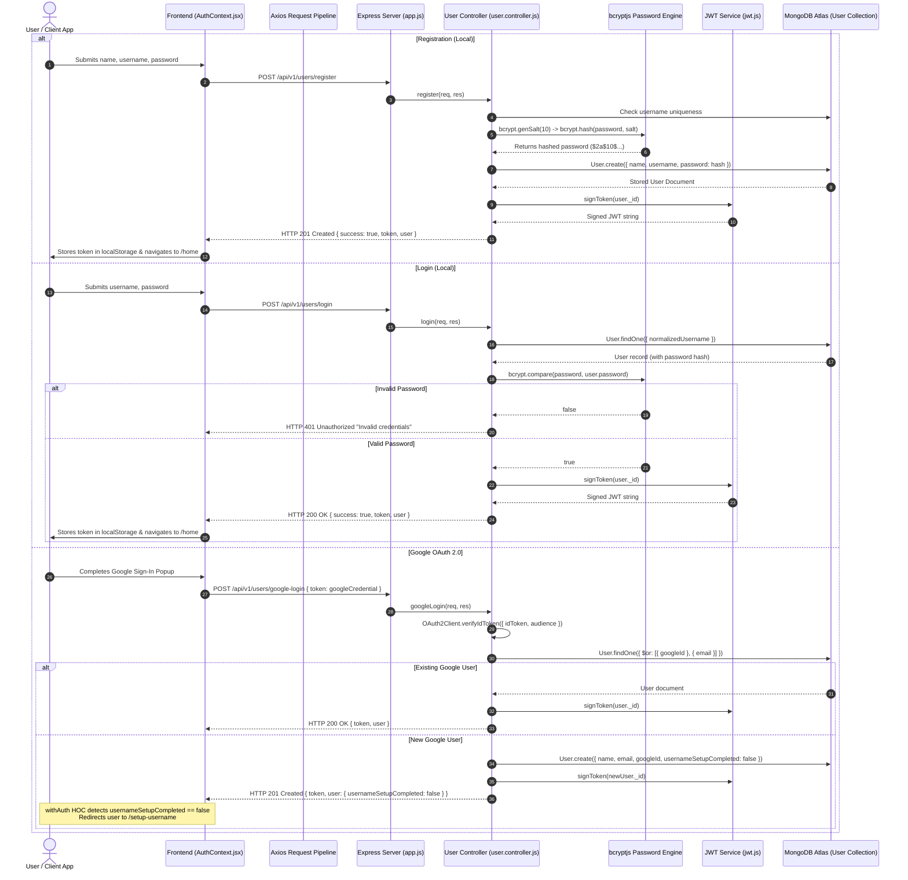

# 06. Authentication & Authorization — Engaze

## Overview of Authentication Architecture

Engaze uses a **stateless JSON Web Token (JWT) architecture** combined with dual-provider authentication:
1. **Local Credentials:** Traditional email/username and password authenticated with **bcryptjs** password hashing.
2. **Third-Party Identity:** **Google OAuth 2.0** verification using Google's official `google-auth-library`.

All authenticated requests carry the token in the standard HTTP header:
```http
Authorization: Bearer <jwt_token>
```

---

## 1. Complete Authentication Sequence Diagram



---

## 2. Password Hashing with bcryptjs

* **Algorithm:** Blowfish-based adaptive hashing with salts.
* **Salt Rounds:** 10 rounds (`bcrypt.genSalt(10)`).
* **Security Attributes:**
  * Resistive to brute-force and dictionary attacks via a work factor of $2^{10} = 1024$ key expansion rounds.
  * Unique per-user random salt ensures identical passwords result in completely distinct hash strings, eliminating pre-computed rainbow table lookups.
  * Passwords are never stored in plain text or logged to disk.

---

## 3. JWT Architecture & Production Security Failsafes

### Token Generation & Claims
```javascript
export const signToken = (userId) => {
    const secret = getJwtSecret();
    return jwt.sign(
        { id: userId.toString() },
        secret,
        { expiresIn: process.env.JWT_EXPIRES_IN || "7d" }
    );
};
```
* **Payload:** Minimal payload containing only `{ id: userId }`. No sensitive personal details (such as email, password hashes, or roles) are encoded into the JWT, preventing client-side data leaks upon token decoding.
* **Signing Algorithm:** HMAC-SHA256 (`HS256`).
* **Expiration (`exp`):** Defaults to 7 days (`7d`).

### Production Startup Failsafe (`src/config/jwt.js`)
To prevent deployment with insecure defaults, Engaze implements an **exit-on-boot configuration validator**:
```javascript
export const validateJwtConfig = ({ exitOnError = true } = {}) => {
    const secret = process.env.JWT_SECRET;
    if (process.env.NODE_ENV === "production") {
        if (!secret || secret.trim() === "") {
            console.error("FATAL: JWT_SECRET environment variable is required in production.");
            if (exitOnError) process.exit(1);
        }
        if (secret.length < 32) {
            console.error("FATAL: JWT_SECRET must be at least 32 characters long in production.");
            if (exitOnError) process.exit(1);
        }
        const insecurePlaceholders = ["secret", "jwt_secret", "changeme", "your_jwt_secret"];
        if (insecurePlaceholders.includes(secret.toLowerCase().trim())) {
            console.error("FATAL: JWT_SECRET cannot use an insecure development placeholder.");
            if (exitOnError) process.exit(1);
        }
    }
};
```
If an engineer attempts to boot the production container on Render with a missing or trivial secret, the process immediately exits with code 1 before exposing the server to traffic.

---

## 4. Protected API Middleware Pipeline

### `protect` (`src/middlewares/auth.middleware.js`)
Intercepts incoming requests and verifies authentication:
1. **Header Parsing:** Checks for `req.headers.authorization` starting with `Bearer `.
2. **Token Extraction:** Strips the `"Bearer "` prefix.
3. **Cryptographic Verification:** Invokes `jwt.verify(token, getJwtSecret())`. If expired or tampered with, immediately throws `JsonWebTokenError` / `TokenExpiredError` returning `401 Unauthorized`.
4. **User Hydration & Account Status:** Queries MongoDB for the user:
   ```javascript
   const user = await User.findById(decoded.id).select("-password");
   ```
5. **Account Standing Verification:**
   * Checks `user.status`. If `user.status === "banned"`, rejects with `403 Forbidden` (`ACCOUNT_BANNED`).
   * If `user.status === "suspended"` and `suspensionExpiresAt > Date.now()`, rejects with `403 Forbidden` (`ACCOUNT_SUSPENDED`).
   * Automatically reinstates suspended users whose suspension period has elapsed.
6. Attaches the clean user document to `req.user` and calls `next()`.

---

## 5. Specialized Authorization Middlewares

### A. Adult Eligibility Policy (`requireEligibility`)
Applied to all dating-specific routes (Discovery feed, Swipes, Match requests, Calls):
```javascript
export const requireEligibility = (req, res, next) => {
    const user = req.user;
    if (!user) return res.status(401).json({ success: false, message: "Unauthorized" });

    const age = calculateExactAge(user.dob);
    if (age === null || age < 18) {
        return res.status(403).json({
            success: false,
            code: "AGE_RESTRICTED",
            message: "You must be at least 18 years old to access dating features."
        });
    }

    if (!user.isProfileComplete || !user.gender || !user.photos?.length) {
        return res.status(403).json({
            success: false,
            code: "PROFILE_INCOMPLETE",
            message: "Please complete your profile and upload at least one photo first."
        });
    }

    next();
};
```

### B. Role-Based Access Control (`requireModerator`)
Applied to `/api/v1/moderation/*` routes:
```javascript
export const requireModerator = (req, res, next) => {
    if (!req.user || !["moderator", "admin"].includes(req.user.role)) {
        return res.status(403).json({
            success: false,
            message: "Access forbidden: Moderator privileges required."
        });
    }
    next();
};
```

### C. Username Onboarding Guard (`requireUsernameCompleted`)
Ensures Google OAuth users cannot access search or discovery until establishing a valid username.
