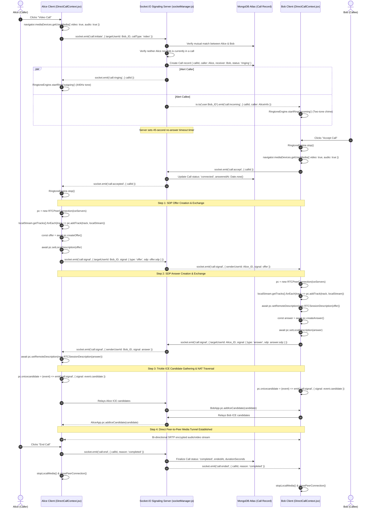

# 08. WebRTC & Video/Audio Calling Deep Dive — Engaze

## WebRTC Fundamentals & Architectural Role in Engaze

**WebRTC (Web Real-Time Communication)** is an open standard that enables peer-to-peer (P2P) audio, video, and data communication directly between web browsers and mobile devices without requiring intermediate media streaming servers.

### Why Engaze Uses WebRTC
1. **Zero Media Bandwidth Costs:** In a dating application with thousands of active calls, routing live video streams through backend servers would incur massive bandwidth bills and require complex SFU/MCU (Selective Forwarding Unit) media clusters. With WebRTC, media flows directly between user devices over encrypted UDP tunnels.
2. **Sub-Second Latency:** Direct P2P transmission provides glass-to-glass latency under 150 ms, essential for natural romantic conversations.
3. **End-to-End Encryption:** All audio and video payloads are mandated by the WebRTC standard to be encrypted via **DTLS (Datagram Transport Layer Security)** and **SRTP (Secure Real-time Transport Protocol)**.

---

## 1. WebRTC vs. Socket.IO: Clear Separation of Concerns

One of the most critical concepts to articulate in technical interviews is the strict division of labor between WebRTC and Socket.IO:

| Operational Responsibility | Technology Used | Why? |
| :--- | :--- | :--- |
| **Media Stream Capture** (Camera/Mic) | **WebRTC (`getUserMedia`)** | Native browser hardware access to encode video/audio frames into VP8/H.264 and Opus codecs. |
| **Call Authentication & Mutual Consent** | **Socket.IO + Express/MongoDB** | Verifies mutual match authorization and ensures neither party has blocked the other. |
| **Call Ringing & High-Priority Push** | **Socket.IO + FCM** | Delivers call notifications and triggers native Android ringtones. |
| **Signaling Gateway** (SDP Offer/Answer & ICE) | **Socket.IO (`call:signal`)** | WebRTC cannot discover peers on its own; Socket.IO acts as the secure postal service relaying connection metadata. |
| **Media Transport** (Video & Audio Packets) | **WebRTC (`RTCPeerConnection`)** | Transports encrypted RTP packets directly peer-to-peer over UDP. **Zero bytes of video pass through Node.js.** |

---

## 2. The Complete Video Calling Sequence Diagram



---

## 3. Media Acquisition & Track Lifecycle Management

### Hardware Acquisition
```javascript
const stream = await navigator.mediaDevices.getUserMedia({
    video: {
        width: { ideal: 1280, max: 1920 },
        height: { ideal: 720, max: 1080 },
        facingMode: "user"
    },
    audio: {
        echoCancellation: true,
        noiseSuppression: true,
        autoGainControl: true
    }
});
```

### In-Call Controls: Mute & Video Toggle
To mute audio or disable video without tearing down the underlying `RTCPeerConnection`:
```javascript
// Toggle Mute Audio
localStream.getAudioTracks().forEach(track => {
    track.enabled = !track.enabled;
});

// Toggle Video (Camera Off)
localStream.getVideoTracks().forEach(track => {
    track.enabled = !track.enabled;
});
```
* **Why `track.enabled = false` instead of `track.stop()`?**
  Setting `track.enabled = false` instructs the media encoder to transmit silent audio packets or black video frames. The WebRTC renegotiation pipeline remains intact, allowing instant unmuting without renegotiating SDP offers.

### Complete Teardown (`stopLocalMedia`)
When the call terminates, hardware access must be immediately released so the Android status bar and browser tab extinguish camera recording indicator dots:
```javascript
const stopLocalMedia = () => {
    if (localStreamRef.current) {
        localStreamRef.current.getTracks().forEach((track) => {
            try {
                track.stop(); // Releases OS camera/mic lock immediately
            } catch (e) {
                console.warn("Error stopping track:", e);
            }
        });
        localStreamRef.current = null;
        setLocalStream(null);
    }
};
```

---

## 4. NAT Traversal: STUN and TURN Explained

Because user devices reside behind home Wi-Fi routers and mobile carrier NATs (Network Address Translation), devices cannot communicate using private IP addresses (e.g., `192.168.1.5`).

### 1. STUN (Session Traversal Utilities for NAT)
* **How it works:** Alice sends a lightweight UDP binding request to a public Google STUN server (`stun:stun.l.google.com:19302`). The STUN server inspects the incoming UDP packet and responds with Alice's public IP address and port mapping as seen from the open internet.
* **Coverage:** Successfully connects ~85% of standard consumer networks.

### 2. TURN (Traversal Using Relays around NAT)
* **When needed:** When symmetric NATs or restrictive cellular firewalls block direct UDP hole punching.
* **How it works:** Media packets are relayed through a public TURN server acting as a secure intermediary.
* **Engaze Configuration (`backend/src/config/webrtc.js`):**
  Provides dynamic STUN/TURN server configurations via `/api/v1/webrtc/ice-servers` with in-memory 5-minute caching on the client.

---

## 5. Android WebView Permission Bridge (`MainActivity.java`)

When running inside Capacitor on Android, the standard browser permission prompt cannot surface automatically. In `MainActivity.java`, Engaze implements a custom `BridgeWebChromeClient` override:
```java
@Override
public void onPermissionRequest(final PermissionRequest request) {
    MainActivity.this.runOnUiThread(() -> {
        // Automatically grants CAMERA and RECORD_AUDIO inside the trusted WebView
        request.grant(request.getResources());
    });
}
```
This is paired with Android runtime permissions declared in `AndroidManifest.xml`:
* `android.permission.CAMERA`
* `android.permission.RECORD_AUDIO`
* `android.permission.MODIFY_AUDIO_SETTINGS`
