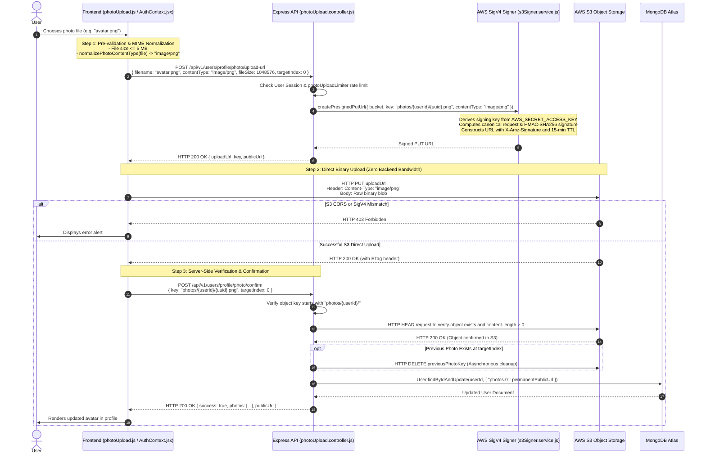

# 09. AWS S3 Profile Photo Upload Architecture — Engaze

## Architectural Rationale: Direct Presigned Storage Pipeline

In conventional web architectures, file uploads are funneled through the application server:
```
Client  ──(5MB Multipart Upload)──>  Express Server  ──(AWS SDK)──>  AWS S3
```
### Why That Pattern Fails at Scale:
1. **Server CPU & Memory Starvation:** Parsing multi-megabyte `multipart/form-data` streams buffers file chunks in Node.js process memory. Under concurrent uploads, Node's single-threaded event loop degrades.
2. **Double Bandwidth Consumption:** The server pays to receive the file ingress and pays again to upload egress to S3.
3. **Slow Request Blocking:** Long-running I/O file uploads consume Express connections, causing latency spikes for standard API calls.

### The Engaze Direct-to-S3 Solution
Engaze completely bypasses the application server for binary file transfers using **AWS Signature Version 4 (SigV4) Presigned PUT URLs**:
```
Client  ──(1. Request Signed URL)──>  Express Backend
Client  <──(2. 15-min Presigned URL)── Express Backend
Client  ──(3. Direct Binary PUT)──>  AWS S3 Bucket
Client  ──(4. Confirm Upload)───────>  Express Backend (HEAD Verification & DB Save)
```

---

## 1. Complete Photo Upload Sequence Diagram



---

## 2. Zero-Dependency AWS SigV4 Signer (`src/services/s3Signer.service.js`)

Rather than installing heavy AWS SDK bundles (`@aws-sdk/client-s3`) that bloat production deployment packages, Engaze implements a **zero-external-dependency AWS Signature Version 4 signing engine** using Node.js's native `node:crypto` library:

### Key Derivation Steps
1. **Derive Signing Key (`kSigning`):**
   ```javascript
   export function getSignatureKey(secretKey, dateStamp, region, service = "s3") {
       const kDate = hmacSha256("AWS4" + secretKey, dateStamp);
       const kRegion = hmacSha256(kDate, region);
       const kService = hmacSha256(kRegion, service);
       const kSigning = hmacSha256(kService, "aws4_request");
       return kSigning;
   }
   ```
2. **Canonical Request Construction:**
   Constructs standard SigV4 canonical URI, canonical query string (alphabetically sorted), canonical headers (`host`), and signed headers (`host`).
3. **String to Sign:**
   ```
   AWS4-HMAC-SHA256
   <ISO8601_Timestamp>
   <DateStamp>/<Region>/s3/aws4_request
   <HashedCanonicalRequest>
   ```
4. **Signature:**
   Computes `hmacSha256(kSigning, stringToSign).toString("hex")` and appends it as `X-Amz-Signature`.

---

## 3. Strict Binary Magic-Bytes Inspection (`src/services/imageValidation.service.js`)

Client-supplied file extensions and `Content-Type` headers cannot be trusted; a malicious actor could rename an executable (`payload.exe`) to `photo.jpg`.

Engaze enforces **Magic-Byte Inspection** directly on binary buffers:
```javascript
export function detectMimeType(buffer) {
    if (!Buffer.isBuffer(buffer) || buffer.length < 12) return null;

    // JPEG Magic Bytes: 0xFF, 0xD8, 0xFF
    if (buffer[0] === 0xFF && buffer[1] === 0xD8 && buffer[2] === 0xFF) {
        return "image/jpeg";
    }

    // PNG Magic Bytes: 0x89, 0x50, 0x4E, 0x47, 0x0D, 0x0A, 0x1A, 0x0A
    if (buffer[0] === 0x89 && buffer[1] === 0x50 && buffer[2] === 0x4E && buffer[3] === 0x47) {
        return "image/png";
    }

    // WebP: 'RIFF' at byte 0..3 and 'WEBP' at byte 8..11
    if (buffer.toString("ascii", 0, 4) === "RIFF" && buffer.toString("ascii", 8, 12) === "WEBP") {
        return "image/webp";
    }

    return null;
}
```

---

## 4. The Android Content-Type & CORS Mismatch Bug & Fix

### The Problem
During development, photo uploads worked seamlessly on the web version but failed consistently on the Android mobile app.

### Root Cause Analysis
1. **MIME Type Drift:** In Android WebViews, when an image is selected from certain native gallery pickers, the browser's `file.type` property is returned as empty string (`""`) or legacy `"image/jpg"`.
   * In Step 1, the frontend requested a presigned URL defaulting to `"image/jpeg"`.
   * In Step 2, the old Axios upload logic defaulted to `"application/octet-stream"`.
   * AWS S3 rejects any PUT upload where the request's `Content-Type` header differs from the signed `Content-Type` query parameter with **`403 SignatureDoesNotMatch`**.
2. **S3 Bucket CORS Policy:** S3 only permitted web origins (`https://www.engaze.date`). Because Capacitor serves the Android app from `https://localhost`, S3 rejected preflight `OPTIONS` requests.

### The Engineering Solution
1. **MIME Normalization Helper (`frontend/src/utils/photoUpload.js`):**
   ```javascript
   export function normalizePhotoContentType(file) {
       if (!file) return "image/jpeg";
       const rawType = (file.type || "").trim().toLowerCase();
       if (rawType.startsWith("image/")) {
           const baseType = rawType.split(";")[0].trim();
           if (baseType === "image/jpg") return "image/jpeg";
           if (ALLOWED_IMAGE_TYPES.includes(baseType)) return baseType;
       }
       const fileName = (file.name || "").toLowerCase();
       if (fileName.endsWith(".png")) return "image/png";
       if (fileName.endsWith(".webp")) return "image/webp";
       return "image/jpeg";
   }
   ```
2. **Parity Guarantees:** The identical `normalizedContentType` is strictly passed to both `requestUploadUrlFn` and `uploadBinaryFn`, and bound to the Axios request header.
3. **AWS S3 CORS Configuration:** Updated the bucket's CORS policy to include `"https://localhost"` and `"capacitor://localhost"`.
